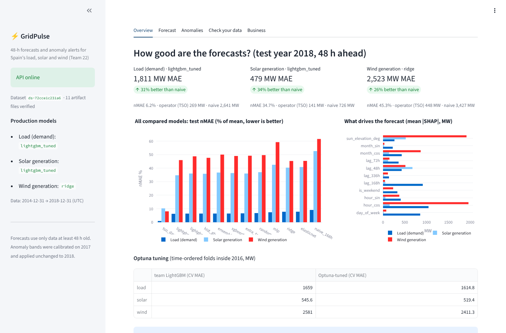
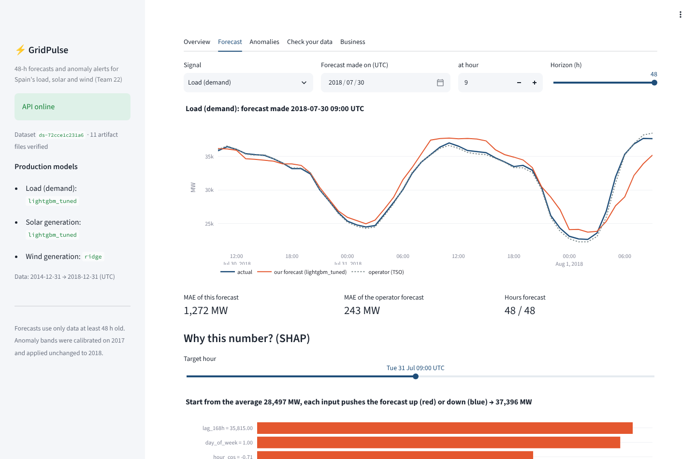
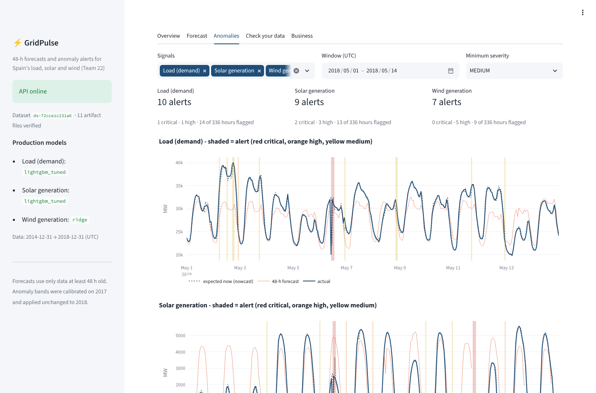
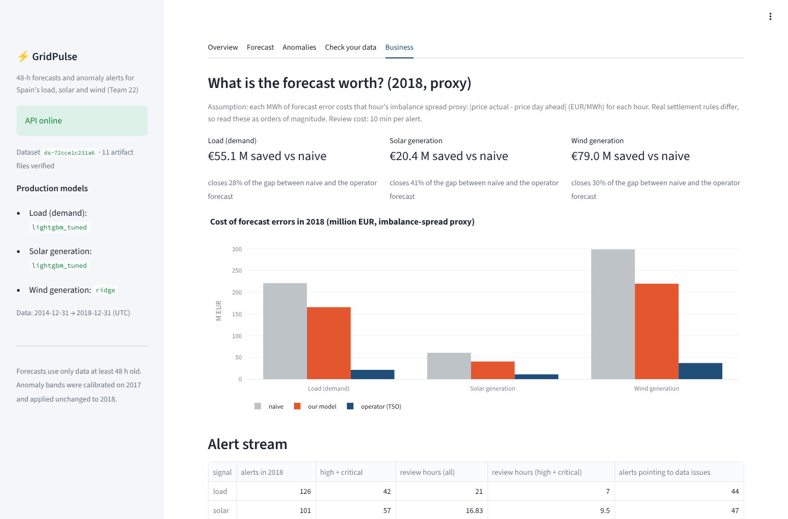
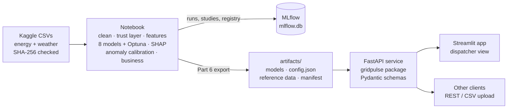

# GridPulse — 48-hour forecasting and anomaly intelligence for Spain's grid

**SIC 8 · AI Track · Project 04 (Renewable Generation Yield & Grid Load Anomaly Intelligence) · Team 22**

Grid dispatchers need two things every day: a forecast of **load, solar and wind** 24–48 hours ahead, and an alert when a value looks wrong (frozen sensor, plant trip, reporting error). GridPulse delivers both as a working system: a notebook that builds and evaluates the models, a **FastAPI** service with **Pydantic** validation, a **Streamlit** dispatcher app and **Docker** images, with **MLflow** tracking and an artifact manifest for reproducibility.

## Results (test year 2018, never used for any choice)

| Signal | Production model (chosen on validation) | MAE 48 h ahead | vs naive (same hour last week) | Operator forecast (TSO) |
|---|---|---|---|---|
| Load | LightGBM, Optuna-tuned | 1,811 MW (6.2 %) | −31 % | 269 MW |
| Solar | LightGBM, Optuna-tuned | 479 MW (34.7 %) | −34 % | 141 MW |
| Wind | Ridge | 2,523 MW (45.3 %) | −26 % | 448 MW |

**Anomaly detection** (trust rules + nowcast band + forecast band, calibrated on 2017): about 2 alerts per signal per week on 2018. In 30 injected cases per fault type it catches 100 % of frozen sensors on every signal, 97 % of wind zero-output events and 100 % of 10 % load drops. Slow solar degradation is mostly missed (a known limit). About a third of the real 2018 alerts point to data problems, for example on 6 May 2018 at 10:00 UTC, when load fell 12.6 GW below the expected value while solar and wind alerted in the same hour.

**Honest limit:** the operator's forecast is far better because it uses weather forecasts this dataset does not contain. Our forecast is an independent second opinion and the expectation behind the alerts. Full discussion: notebook Parts 3–5.

## Screenshots
| Overview | Forecast + SHAP | Anomalies | Business |
|---|---|---|---|
|  |  |  |  |

## Architecture



- The notebook writes the serving bundle in **version-safe formats**: LightGBM text, linear coefficients as JSON (XGBoost JSON is also supported). The manifest stores the SHA-256 of every file, and the API **refuses to start** if a file is missing or altered.
- The `gridpulse` package reproduces the notebook logic. **Parity tests** check that the service gives the same forecasts (to 0.05 MW) and the same 342 alerts of 2018, with the same severity and evidence.
- Forecasts use only data that is **at least 48 hours old** (lags 48/72/168/336 h + calendar). A leakage test corrupts the future and checks that the forecast does not change.

## Run it

### Docker (recommended)
```bash
docker compose up --build            # API  -> http://localhost:8000/docs
                                     # App  -> http://localhost:8501
docker compose --profile mlops up    # + MLflow UI -> http://localhost:5000
```

### Local
```bash
python -m pip install -r requirements/dev.txt     # Python 3.13; Linux needs libgomp1 for LightGBM
make test                                         # 21 tests
make api                                          # terminal 1
make ui                                           # terminal 2
```

## API

| Method | Path | What it does |
|---|---|---|
| GET | `/health` | Status, dataset version, verified artifact files, production models |
| GET | `/info` | Model card: metrics, tuning, SHAP importance, anomaly policy and evaluation |
| GET | `/metrics/models?split=test` | Every compared model (baselines, 8 ML models, tuned LightGBM, ensemble) |
| GET | `/business` | Cost of forecast errors (imbalance-spread proxy), alert workload, injected-fault recall |
| POST | `/forecast` | 1–48 h forecast as of an origin hour, with optional SHAP contributions per hour |
| POST | `/forecast/custom` | Forecast from your own hourly history (≥ 336 h) |
| POST | `/anomaly/scan` | Run the detectors on the reference data in a window (hourly flags + events + evidence) |
| POST | `/anomaly/check` | Run the detectors on your own hourly data (JSON) |
| POST | `/anomaly/upload` | Same with a CSV file |
| GET | `/alerts/2018` | The 2018 alerts produced by the notebook |
| GET | `/data/series` | Actual and operator series for charts |

```bash
curl -s -X POST localhost:8000/forecast -H 'Content-Type: application/json' \
  -d '{"signal":"load","origin_utc":"2018-07-30T09:00:00Z","horizon_hours":48,"explain":true,"top_k":5}'

curl -s -X POST localhost:8000/anomaly/scan -H 'Content-Type: application/json' \
  -d '{"start_utc":"2018-05-01T00:00:00Z","end_utc":"2018-05-14T23:00:00Z","min_severity":"HIGH"}'
```

**Upload format** (`/anomaly/upload`, `/anomaly/check`): hourly rows `time_utc,value_mw` in UTC, plus optional `wx_temp, wx_humidity, wx_wind_speed, wx_pressure, wx_clouds_all` (5-city means). The first 35 days are history; later hours are checked. Missing weather is taken from the reference data when the hours match, otherwise the response warns that the nowcast is less accurate.

Errors: `422` for invalid input (unknown signal, timestamp not on a whole hour, horizon > 48, window reversed), `400` when the request cannot be served (origin outside the data, not enough history), `413` for files over 5 MB.

## MLOps

| Concern | How it is handled |
|---|---|
| Data versioning | Raw-file SHA-256 checked in the notebook; `dataset_version` travels with every artifact and API response |
| Experiment tracking | MLflow: one run per (signal, model), Optuna studies with all trials, anomaly detector, serving bundle |
| Model registry | `gridpulse-forecast-{load,solar,wind}` registered in MLflow |
| Artifact integrity | `artifacts/manifest.json` with SHA-256 per file, verified at API start-up and in tests |
| Reproducibility | Pinned requirements matching the training versions; the notebook runs top to bottom |
| Testing | Parity with the notebook, leakage, injected-fault detection, API contract (`tests/`) |
| CI | `.github/workflows/ci.yml`: tests, image build, health checks |
| Containers | Non-root users, health checks, artifacts baked into the API image |

**Updating the models:** run the notebook (Colab or local), download `gridpulse_outputs/`, then:
```bash
make sync NB_OUT=/path/to/gridpulse_outputs   # copies artifacts/ and the MLflow store, verifies hashes
make test && docker compose up --build
```

## Repository layout
```
notebooks/GridPulse_Team22_final.ipynb  analysis, models, tuning, MLflow, SHAP, anomaly, business, export
artifacts/                              serving bundle written by the notebook (Part 6)
src/gridpulse/                          quality rules, features, models, forecast + anomaly services
api/                                    FastAPI app and Pydantic schemas
ui/                                     Streamlit dispatcher app
tests/                                  pytest suite
docker/, docker-compose.yml             images for api, ui and mlflow
mlflow/                                 MLflow store from the notebook run (runs + registry)
scripts/sync_artifacts.py               bring a new notebook run into the repo
```

## Data
[Hourly energy demand, generation and weather — Spain 2015–2018](https://www.kaggle.com/datasets/nicholasjhana/energy-consumption-generation-prices-and-weather) (CC0). Sources: ENTSO-E (energy), Red Eléctrica (prices), OpenWeather (5 cities). Splits: train 2015–2016, validation 2017, test 2018, with 48-hour gaps between them.

## Limitations
- No weather forecasts: the operator forecast remains much more accurate; wind is the weakest signal (R² ≈ 0.1).
- Alert thresholds come from 2017 and were checked with injected faults, because real fault labels do not exist. Slow degradation needs drift monitoring.
- The cost figures are a proxy (|final price − day-ahead price| per MWh of error), not settlement amounts.
- The data stops at 2018; Spain's solar capacity has grown a lot since, so the models must be retrained before any use on current data.

## Team contributions
_Fill in each member's responsibilities and the components they built (required by the handbook)._
